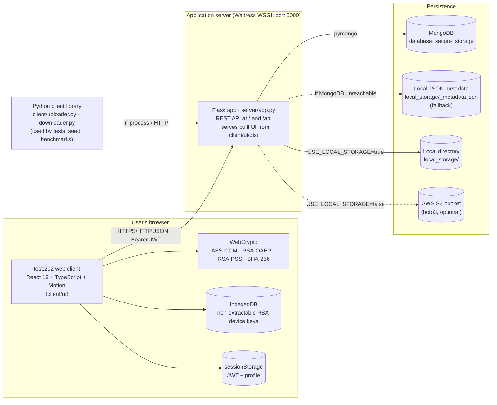
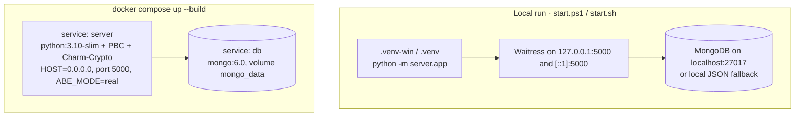
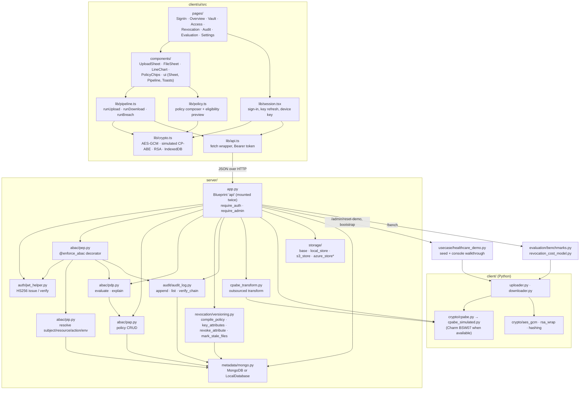
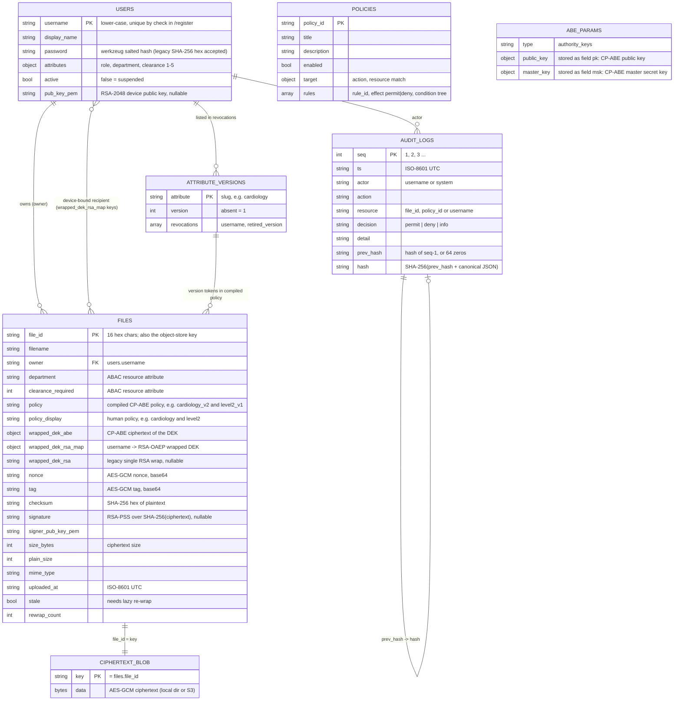
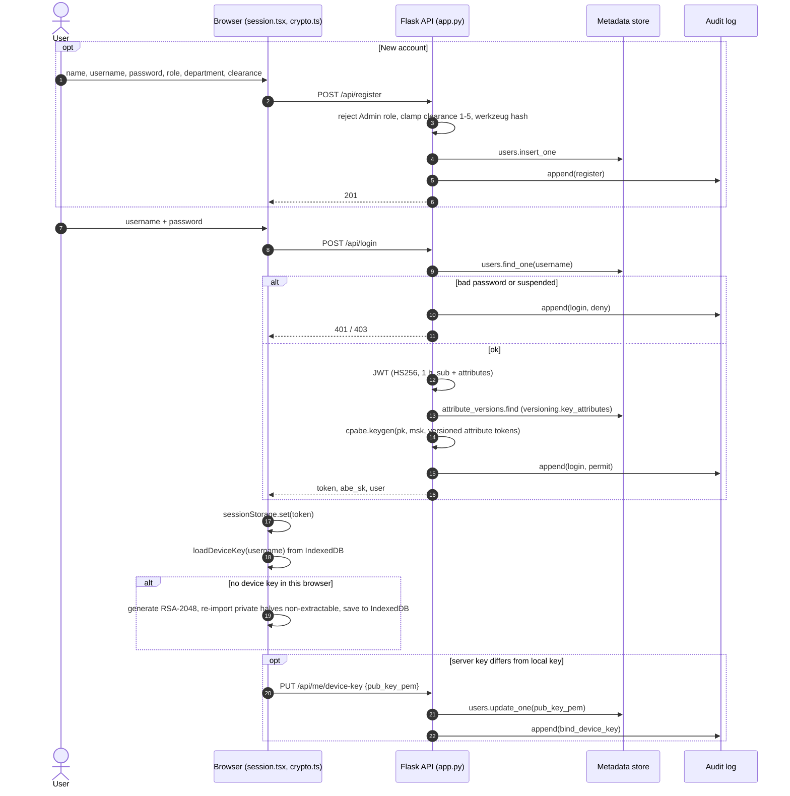
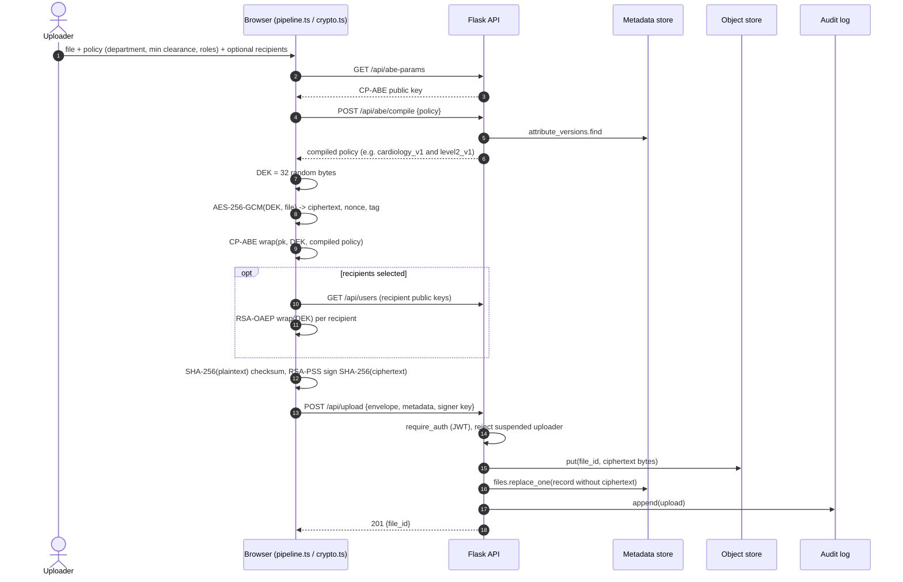
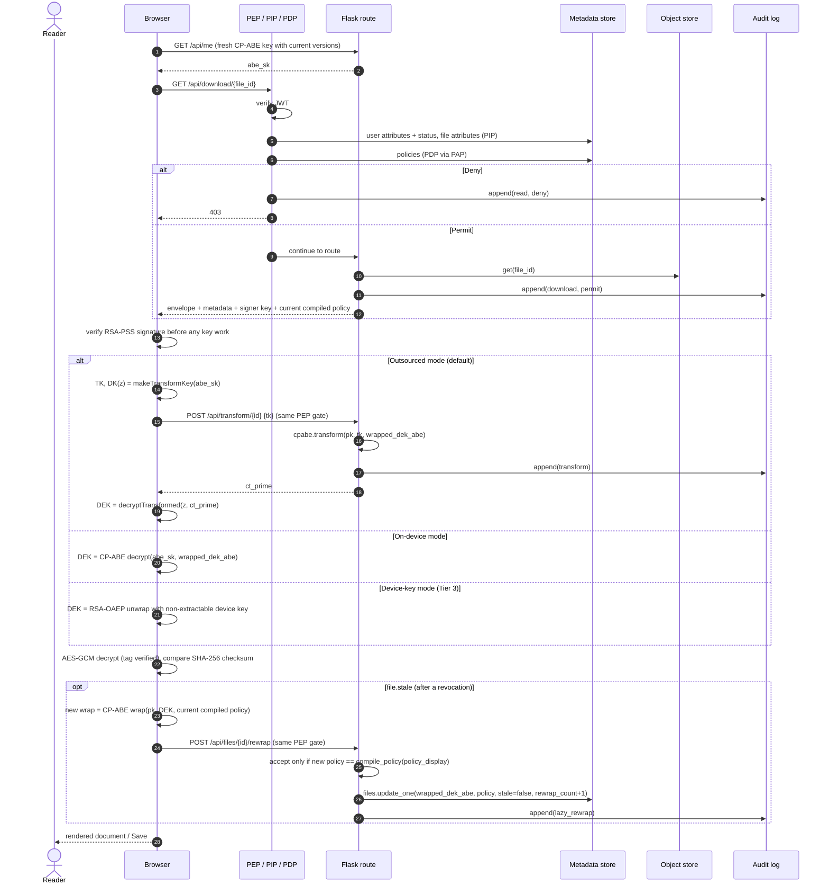
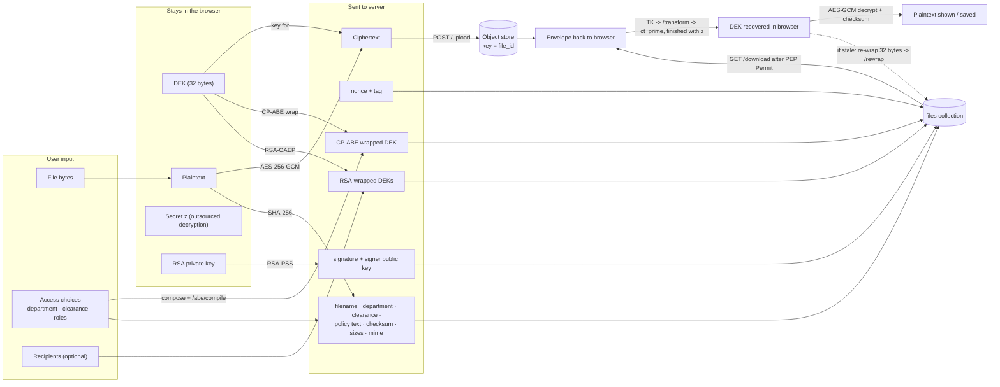

# test:202 — System Design

**Privacy-Preserving Secure Cloud Storage with Hybrid Encryption and Attribute-Based Access Control**
Vansh Sharma · Kushagra Goyal · Geetanshi Singh · Himanshi Kumar — Department of Computer Science & Engineering

This document describes the system as it exists in this repository. File paths are given so each statement can be checked against the code.

---

## 1. Overview

test:202 is a client-centric, zero-trust file store. Files are encrypted in the browser before upload, and decryption depends on the user's **attributes** (role, department, clearance) rather than on keys the storage provider holds.

Each file is protected by a three-tier key hierarchy:

| Tier | Mechanism | Purpose | Code |
|---|---|---|---|
| 1 | AES-256-GCM with a fresh 32-byte DEK per file | Confidentiality and integrity of file bytes | `client/ui/src/lib/crypto.ts`, `client/crypto/aes_gcm.py` |
| 2 | CP-ABE wrap of the DEK under an attribute policy | Cryptographic authorisation | `client/crypto/cpabe.py`, `cpabe_simulated.py` |
| 3 | RSA-OAEP-SHA256 wrap of the DEK to a recipient's device key (optional) | Device binding / direct share | `crypto.ts` (`rsaWrap`), `client/crypto/rsa_wrap.py` |

Ciphertext is additionally signed (RSA-PSS over SHA-256 of the ciphertext). Every read is checked twice: by an ABAC policy engine on the server, and by the CP-ABE policy on the wrapped key.

---

## 2. High-level architecture

**Deployment options that exist in the repository:**

The web client is a static build (`npm run build` → `client/ui/dist`) served by the same Flask process; there is no separate frontend server in production. In development, Vite serves the UI on :5173 and proxies `/api` to :5000 (`client/ui/vite.config.ts`).

---

## 3. Component diagram

\* `server/storage/azure_store.py` implements the `ObjectStore` interface but is **not selected anywhere** in `app.py`; only `LocalStore` and `S3Store` are wired in.

**Note on code placement:** the server imports `client/crypto/cpabe.py` directly. The authority uses it for `setup` and `keygen`, and `cpabe_transform.py` uses it for `transform`. The Python CP-ABE module is therefore shared between client-side tooling and the server.

---

## 4. Database schema

MongoDB is schemaless; the structure below is what the code reads and writes. There are no foreign-key constraints and no indexes are created by the code. Relationships are logical, by key value. The same documents are used by the local JSON fallback (`LocalDatabase` in `server/metadata/mongo.py`).

**Client-side storage (browser):**

| Store | Key | Contents | Code |
|---|---|---|---|
| IndexedDB `tessera-device` / `keys` | username | `{ oaepPriv, pssPriv (non-extractable CryptoKey), publicPem, fingerprint }` | `lib/crypto.ts` |
| sessionStorage `tessera.session` | — | JWT and public profile | `lib/session.tsx` |
| localStorage `tessera.theme` | — | appearance preference only | `main.tsx`, `pages/Settings.tsx` |

The CP-ABE secret key is held in React state only (re-fetched via `/me`), not persisted.

---

## 5. Key user flows

### 5.1 Registration, login and device-key binding

### 5.2 Upload (three-tier wrap) — `runUpload` in `lib/pipeline.ts`

### 5.3 Download: ABAC gate, outsourced decryption, lazy re-wrap — `runDownload`

Preceded, when relevant, by an administrator revoking an attribute (`POST /api/admin/revoke`). That updates the user's directory attributes, bumps the attribute version and sets `stale=true` on every file whose policy uses it.

---

## 6. Data flow

Every state-changing or access-decision step also appends to `audit_logs` (see §8).

---

## 7. Technology stack and rationale

| Layer | Technology (as used) | Why |
|---|---|---|
| Web client | React 19, TypeScript, Vite 8 (`client/ui/package.json`) | Component model for the multi-page app; type safety for crypto envelope shapes; fast static build served by Flask |
| Motion / UI | `motion` (springs, layout animations), `lucide-react` icons, self-hosted Inter via `@fontsource-variable/inter` | Interruptible spring animations; no runtime CDN dependency |
| Client crypto | Browser **WebCrypto** (`crypto.subtle`) | Native AES-GCM, RSA-OAEP, RSA-PSS, SHA-256; private keys can be non-extractable |
| API server | Python 3, **Flask** 3, **Waitress** WSGI | Same language as the crypto core and Charm-Crypto; Waitress is a production server that listens on IPv4 and IPv6 loopback |
| Server / Python crypto | PyCA `cryptography` (AES-GCM, RSA-OAEP, RSA-PSS) | Audited, standard primitives |
| Attribute-based crypto | Charm-Crypto BSW07 CP-ABE (`ABE_MODE=real`, Docker); simulated module otherwise | BSW07 is the scheme named in the specification; the fallback keeps the same interface where PBC cannot be built |
| Auth | PyJWT (HS256), werkzeug password hashing | Stateless bearer tokens carrying ABAC subject claims |
| Metadata | MongoDB via `pymongo`; JSON-file fallback | Flexible documents for nested envelopes and policy trees |
| Object storage | Local directory or AWS S3 (`boto3`) behind `ObjectStore` | Keeps large ciphertext out of the database; pluggable backend |
| Evaluation | `matplotlib`, custom timers | CSV + PNG output in `evaluation/results/` |
| Testing | `pytest` (38 tests) | Crypto round-trips, ABAC, API end-to-end, revocation, audit tamper detection |
| Packaging | Docker (python:3.10-slim + PBC 0.5.14 + Charm), docker-compose with `mongo:6.0` | Reproducible build of the native pairing library |

---

## 8. API endpoints

All routes are registered on one blueprint mounted at both `/` (legacy, used by the Python tests) and `/api` (used by the web client). "PEP" means the route is wrapped in `@pep.enforce_abac("read")`.

| Method | Path | Auth | Purpose | Audit event |
|---|---|---|---|---|
| GET | `/health` | none | version, CP-ABE mode, metadata and storage backends, demo flag | — |
| GET | `/abe-params` | none | CP-ABE public key | — |
| GET | `/abe/versions` | none | current attribute versions | — |
| POST | `/abe/compile` | none | compile human policy → versioned policy; list unknown attributes | — |
| POST | `/register` | none | create account (Admin role refused, clearance clamped 1–5) | `register` |
| POST | `/login` | none | verify password; return JWT + CP-ABE key | `login` permit/deny |
| GET | `/me` | JWT | profile + freshly issued CP-ABE key | — |
| PUT | `/me/device-key` | JWT | bind RSA public key | `bind_device_key` |
| GET | `/users` | JWT | public profiles (incl. public keys) | — |
| GET | `/policies` | none | list ABAC policies | — |
| POST | `/policies` | Admin | create / replace policy | `policy_upsert` |
| PATCH | `/policies/<policy_id>` | Admin | enable / disable | `policy_toggle` |
| DELETE | `/policies/<policy_id>` | Admin | delete | `policy_delete` |
| POST | `/abac/simulate` | JWT | PDP `explain()` on hypothetical attributes (not logged) | — |
| POST | `/upload` | JWT | store ciphertext + envelope metadata | `upload` |
| GET | `/files` | JWT | catalogue with a live PDP decision per file for the caller | — |
| GET | `/download/<file_id>` | JWT + PEP | envelope + ciphertext | `download` (deny logged by PEP) |
| POST | `/transform/<file_id>` | JWT + PEP | outsourced CP-ABE transform | `transform` |
| POST | `/files/<file_id>/rewrap` | JWT + PEP | lazy re-wrap; only under the current compiled policy | `lazy_rewrap` |
| DELETE | `/files/<file_id>` | owner or Admin | delete blob + record | `delete` |
| GET | `/breach/<file_id>` | JWT, `DEMO_MODE=true` | ciphertext **without** ABAC (demonstration) | `breach_simulation` |
| POST | `/admin/revoke` | Admin | revoke role / department / clearance | `revoke_attribute` |
| POST | `/admin/users/<username>/active` | Admin | suspend / reinstate | `suspend_user` / `reinstate_user` |
| POST | `/admin/reset-demo` | Admin | re-seed demo data | `demo_reset` |
| GET | `/audit` | JWT | latest entries (`?limit=`, default 300) | — |
| GET | `/audit/verify` | JWT | recompute the hash chain | — |
| GET | `/bench` | JWT | quick benchmark sweep | — |
| GET | `/`, `/assets/*`, `/<name>.<svg,png,ico,txt,webmanifest>` | none | built web client | — |

---

## 9. Authentication and security approach

**Authentication**
- Passwords are stored with `werkzeug.security.generate_password_hash` (salted, scrypt by default). Old unsalted SHA-256 hex hashes are still verified, with a constant-time comparison (`_check_password`).
- Login issues an HS256 JWT (`server/auth/jwt_helper.py`) with `sub`, `iat`, `exp` (1 hour) and the subject's attributes. The client sends it as `Authorization: Bearer …`.
- `require_auth` verifies the token and loads the directory record; `require_admin` additionally requires the role `admin`.

**Authorisation — ABAC (NIST SP 800-162 roles)**
- **PEP** (`abac/pep.py`) intercepts gated routes. **PIP** (`abac/pip.py`) re-reads subject attributes and account status from the directory on every request, rather than trusting the JWT claims, plus resource attributes (owner, department, clearance, recipients) and environment attributes (UTC hour, local hour, day, IP). **PDP** (`abac/pdp.py`) evaluates JSON condition trees (`and`/`or`/`not`, `eq`/`neq`/`gt`/`gte`/`lt`/`lte`, `in`, and `$`-references between attributes) with deny-override and deny-by-default. **PAP** (`abac/pap.py`) stores policies.
- Seeded policies: suspended-accounts (deny), owner-access, direct-share, department-clearance, business-hours (disabled by default).

**Authorisation — cryptographic**
- The DEK is wrapped under a CP-ABE policy compiled to versioned attributes. A user's key carries their attribute tokens; clearance is a ladder (clearance 3 → `level1..level3`).
- **Outsourced decryption:** the server transforms with a TK; the final step needs `z`, which stays in the browser.

**Confidentiality and integrity**
- AES-256-GCM with a fresh DEK and 96-bit random nonce per file; GCM tag, SHA-256 plaintext checksum and an RSA-PSS (SHA-256, salt length 222) signature over SHA-256(ciphertext). The browser verifies the signature before unwrapping any key.
- Device private keys are re-imported into WebCrypto as **non-extractable** before being stored in IndexedDB.

**Revocation**
- Instant at the ABAC layer: a directory update or suspension takes effect on the next request, because the PIP reads the directory each time.
- Cryptographic, lazy: the attribute version is bumped and files are flagged `stale`; the next authorised reader re-wraps the DEK. `/rewrap` rejects any policy other than the current compiled one. Revoked users never re-receive retired versions (`_revoked_pairs`).

**Audit**
- Append-only, hash-chained entries; `verify_chain()` locates the first broken link. Appends are serialised with a process-local lock.

---

## 10. Scalability considerations

What helps:
- **Stateless API.** Authentication is a self-contained JWT, so Flask workers need no shared session store.
- **Ciphertext is decoupled from metadata.** Large blobs go to the object store (local or S3); MongoDB holds only small records.
- **Revocation cost is O(32 bytes) per affected file**, and it is deferred to the next access (`evaluation/revocation_cost_model.py`).
- **Outsourced decryption** moves the expensive CP-ABE step off the client.

Constraints in the current code:
- **Whole files in memory.** Uploads and downloads are single base64 JSON bodies (limit `MAX_CONTENT_LENGTH` = 80 MB, UI limit 50 MB). There is no streaming or chunking on either side.
- **`GET /files` runs the PDP once per file** for the caller, and `mark_stale_files` scans every file record: both are O(number of files).
- **No database indexes** are created (e.g. on `files.file_id`, `users.username`, `audit_logs.seq`).
- **The audit chain uses a process-local `threading.Lock`.** With multiple server processes, concurrent appends could compute the same `seq`/`prev_hash`. It is safe only with the single Waitress process (8 threads) used here.
- **CP-ABE parameters are cached in a module-global** per process (`abe_pk`, `abe_msk`).
- **The local JSON metadata fallback** rewrites the whole file on every write and is single-process only. It is intended as a demo safety net.

---

## 11. Known limitations

1. **Simulated CP-ABE outside Docker.** Charm-Crypto (BSW07) needs PBC, which is built only in the Docker image. Elsewhere, `cpabe_simulated.py` is used. In that module the "public key", user secret key and transformation key all embed the same symmetric master key, and policy checks are enforced in code. It reproduces the interface and policy semantics but **provides no cryptographic access control**: anyone holding a simulated key or TK, including the server receiving a TK, could unwrap any DEK. The security claims of Tier 2 hold only with `ABE_MODE=real`.
2. **The browser implements only the simulated wire format.** With `ABE_MODE=real`, the web client refuses Tier 2 operations (`assertBrowserEngine`), and the Python client must be used.
3. **Self-asserted attributes.** `/register` lets users choose their role, department and clearance (only Admin is blocked, and clearance is clamped to 1–5). There is no attribute-authority verification step.
4. **Demo affordances.** A default `JWT_SECRET`, seeded demo passwords, and the `/breach` endpoint (enabled while `DEMO_MODE=true`, the default) are for demonstration.
5. **Token handling.** JWTs live in `sessionStorage` (readable by any script on the page if XSS existed). There is no refresh token, denylist or rate limiting. Suspension is still enforced on every gated request via the PIP.
6. **Open read endpoints.** `GET /policies`, `/abe-params`, `/abe/versions` and `POST /abe/compile` require no authentication.
7. **Lazy re-wrap depends on access.** Files never opened again after a revocation stay wrapped under the old version; until then only the ABAC layer stops a revoked user who already holds an old key.
8. **Audit chain is not externally anchored or signed.** It detects edits to individual entries, but someone with write access to the whole collection could rebuild a consistent chain.
9. **Device keys are per browser.** Clearing site data or using another browser creates a new key; files bound to the old key can no longer be unwrapped with Tier 3.
10. **Azure Blob storage** is implemented (`azure_store.py`) but not wired into `app.py`, and `azure-storage-blob` is not in `requirements.txt`.
11. **Post-quantum wrapping** (ML-KEM / lattice ABE) and **multi-authority ABE** are not implemented. They are future work in the specification.
12. **No indexes, no streaming, single-process audit lock** — see §10.
